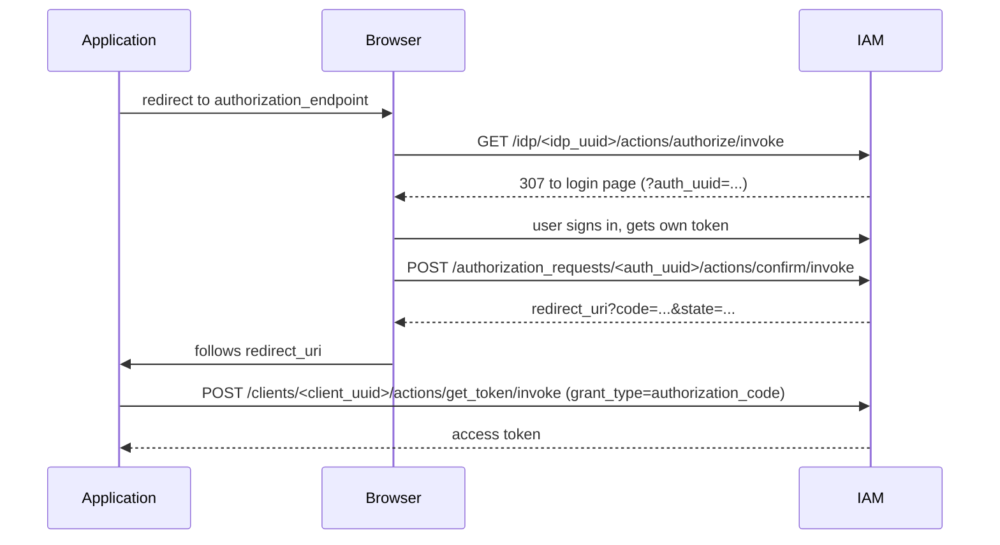

# OAuth2 Authorization Code Flow

IAM can act as an OpenID Connect Identity Provider (IdP) for external
applications. An application (Relying Party) redirects the user to IAM, the
user signs in, and the application receives a one-time **authorization code**
that it exchanges for an access token.

## Entities

* **IAM client** (`/v1/iam/clients/<client_uuid>`) — issues tokens. Its
  `client_id` is used as the token `audience`.
* **IdP** (`/v1/iam/idp/<idp_uuid>`) — binds an IAM client to the allowed
  callback URIs. Main fields:
    * `iam_client` — the IAM client used to issue tokens;
    * `scope` — default scope (`openid`);
    * `callback` — allowed `redirect_uri` values, one of:
        * `callback_uri` — exact match with `callback`;
        * `callback_uri_list` — exact match with any item of `callbacks`;
        * `callback_regexp` — full match with the regular expression `pattern`;
    * `nonce_required` — whether `nonce` is mandatory (default `true`).
* **Authorization request** (`/v1/iam/authorization_requests/<uuid>`) —
  a short-lived record created by `authorize`. It stores `state`, `nonce`,
  `scope`, `redirect_uri`, the generated `code` (UUID) and, after
  confirmation, the issued token.

## Discovery

The IdP publishes its OpenID configuration:

```text
GET /v1/iam/idp/<idp_uuid>/.well-known/openid-configuration
```

| Field                    | Endpoint                                                  |
|--------------------------|-----------------------------------------------------------|
| `issuer`                 | `/v1/iam/clients/<client_uuid>`                           |
| `authorization_endpoint` | `/v1/iam/idp/<idp_uuid>/actions/authorize/invoke`         |
| `token_endpoint`         | `/v1/iam/clients/<client_uuid>/actions/get_token/invoke`  |
| `userinfo_endpoint`      | `/v1/iam/clients/<client_uuid>/actions/userinfo`          |
| `jwks_uri`               | `/v1/iam/clients/<client_uuid>/actions/jwks`              |
| `end_session_endpoint`   | `/v1/iam/clients/<client_uuid>/actions/logout/invoke`     |

Only the `code` response type is supported.

## Flow



### 1. Authorize

```text
GET /v1/iam/idp/<idp_uuid>/actions/authorize/invoke
    ?client_id=<client_id>
    &redirect_uri=<redirect_uri>
    &state=<state>
    &response_type=code
    &scope=openid
    &nonce=<nonce>
```

IAM checks that:

* `client_id` matches the IdP's IAM client;
* `redirect_uri` is allowed by the IdP `callback`;
* `nonce` is present if `nonce_required` is enabled.

IAM then creates an authorization request with a random `code`, valid for
10 minutes, and answers with `307` to the IAM login page:

```text
/?auth_uuid=<auth_uuid>&client_uuid=<client_uuid>&idp_uuid=<idp_uuid>
```

### 2. Confirm

After the user signs in, the login page confirms the request with the user's
token:

```bash
curl -X POST \
  -H "Authorization: Bearer <user_token>" \
  '<base_url>/v1/iam/authorization_requests/<auth_uuid>/actions/confirm/invoke'
```

IAM issues a new token for the user with the IdP's IAM client, the
requested `scope` and `nonce`, and the user's current project. The token is
attached to the authorization request. The response contains the callback URL:

```json
{
  "redirect_url": "<redirect_uri>?code=<code>&state=<state>"
}
```

Pass `redirect_me=true` to get a `307` redirect to this URL instead.

### 3. Exchange the code for a token

```bash
curl -X POST \
  '<base_url>/v1/iam/clients/<client_uuid>/actions/get_token/invoke' \
  --data-urlencode 'grant_type=authorization_code' \
  --data-urlencode 'code=<code>' \
  --data-urlencode 'redirect_uri=<redirect_uri>'
```

IAM finds the authorization request by `code`, deletes it and returns the
token issued at the confirm step. The code can be used only once; an unknown
or already used code returns an invalid credentials error.

## Seeding an IdP at bootstrap

An installation can come up with its IdPs already in place: the bootstrap
spec may carry an `idps` list, and bootstrap creates every IdP in it,
together with the IAM client it issues tokens through. Both are created in
the service project. An IdP or a client whose `uuid` already exists is left
as it is, so a re-run of bootstrap never changes what was seeded or edited
since; an entry that cannot be read is logged and skipped.

```json
{
  "idps": [
    {
      "uuid": "<idp uuid>",
      "name": "Elementizer agent",
      "description": "Sign an agent in to the realm",
      "scope": "openid",
      "nonce_required": true,
      "callback": {
        "kind": "callback_regexp",
        "pattern": "^http://127\\.0\\.0\\.1:[0-9]+/callback$"
      },
      "iam_client": {
        "uuid": "<client uuid>",
        "name": "Elementizer agent",
        "description": "Agents deploying through Elementizer",
        "client_id": "elementizer-agent",
        "registration_auto_provision": false
      }
    }
  ]
}
```

`callback` takes any of the three kinds described above. The client is
created with a random secret nobody holds: exchanging an authorization code
for a token sends no client secret, so a public client such as an agent on
the user's machine needs none.
