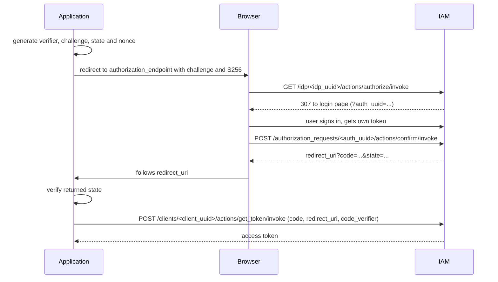

# OAuth2 Authorization Code Flow

IAM can act as an OpenID Connect Identity Provider (IdP) for external
applications. An application (Relying Party) redirects the user to IAM, the
user signs in, and the application receives a one-time **authorization code**
that it exchanges for an access token.

Use [PKCE S256](pkce.md) for new integrations, including public clients such
as desktop applications and agents. The examples below use PKCE. Existing
clients can continue the flow without PKCE for compatibility.

## Entities

* **IAM client** (`/v1/iam/clients/<client_uuid>`) — issues tokens. Its
  `client_id` is used as the token `audience`.
* **IdP** (`/v1/iam/idp/<idp_uuid>`) — binds an IAM client to the allowed
  callback URIs. Main fields:
    * `iam_client` — the IAM client used to issue tokens;
    * `scope` — default scope (`openid`);
    * `callback` — allowed `redirect_uri` values, one of:
        * `callback_uri` — exact match with `callback`;
        * `callback_uri_list` — exact match with any item of `callbacks`;
        * `callback_regexp` — full match with the regular expression `pattern`;
    * `nonce_required` — whether `nonce` is mandatory (default `true`).
* **Authorization request** (`/v1/iam/authorization_requests/<uuid>`) —
  a short-lived record created by `authorize`. It stores `state`, `nonce`,
  `scope`, `redirect_uri`, the generated `code` (UUID) and, after
  confirmation, the issued token. With PKCE it also stores `code_challenge`
  and `code_challenge_method`; the verifier stays with the application.

## Discovery

The IdP publishes its OpenID configuration:

```text
GET /v1/iam/idp/<idp_uuid>/.well-known/openid-configuration
```

| Field                    | Endpoint                                                  |
|--------------------------|-----------------------------------------------------------|
| `issuer`                 | `/v1/iam/clients/<client_uuid>`                           |
| `authorization_endpoint` | `/v1/iam/idp/<idp_uuid>/actions/authorize/invoke`         |
| `token_endpoint`         | `/v1/iam/clients/<client_uuid>/actions/get_token/invoke`  |
| `userinfo_endpoint`      | `/v1/iam/clients/<client_uuid>/actions/userinfo`          |
| `jwks_uri`               | `/v1/iam/clients/<client_uuid>/actions/jwks`              |
| `end_session_endpoint`   | `/v1/iam/clients/<client_uuid>/actions/logout/invoke`     |

Only the `code` response type is supported. PKCE support is advertised as
`code_challenge_methods_supported: ["S256"]`. Check this before starting a
PKCE login; a realm without S256 support needs a Core IAM update.

## Flow



### Prepare the login attempt

Generate a fresh random `state` and `nonce` for each login and keep them
locally. Generate a secret `code_verifier` and derive its challenge:

```python
import base64
import hashlib
import secrets

code_verifier = secrets.token_urlsafe(32)
code_challenge = base64.urlsafe_b64encode(
    hashlib.sha256(code_verifier.encode("ascii")).digest()
).rstrip(b"=").decode("ascii")
```

Keep the verifier locally until the token exchange. Send only the challenge
in the authorization URL; do not put the verifier in browser URLs or logs.

### 1. Authorize

```text
GET /v1/iam/idp/<idp_uuid>/actions/authorize/invoke
    ?client_id=<client_id>
    &redirect_uri=<redirect_uri>
    &state=<state>
    &response_type=code
    &scope=openid
    &nonce=<nonce>
    &code_challenge=<code_challenge>
    &code_challenge_method=S256
```

IAM checks that:

* `client_id` matches the IdP's IAM client;
* `redirect_uri` is allowed by the IdP `callback`;
* `nonce` is present if `nonce_required` is enabled;
* when PKCE parameters are supplied, the challenge is 43 Base64url characters
  without padding and the method is explicitly `S256`. `plain` and an omitted
  method are rejected.

IAM then creates an authorization request with a random `code`, valid for
10 minutes, and answers with `307` to the IAM login page:

```text
/?auth_uuid=<auth_uuid>&client_uuid=<client_uuid>&idp_uuid=<idp_uuid>
```

### 2. Confirm

After the user signs in, the login page confirms the request with the user's
token:

```bash
curl -X POST \
  -H "Authorization: Bearer <user_token>" \
  '<base_url>/v1/iam/authorization_requests/<auth_uuid>/actions/confirm/invoke'
```

IAM issues a new token for the user with the IdP's IAM client, the
requested `scope` and `nonce`, and the user's current project. The token is
attached to the authorization request. The response contains the callback URL:

```json
{
  "redirect_url": "<redirect_uri>?code=<code>&state=<state>"
}
```

Pass `redirect_me=true` to get a `307` redirect to this URL instead.

### 3. Exchange the code for a token

Before exchanging, compare the returned `state` with the value saved for this
login attempt; reject a missing or mismatched value. Send the original
verifier and exactly the same `redirect_uri` used when authorizing:

```bash
curl -X POST \
  '<base_url>/v1/iam/clients/<client_uuid>/actions/get_token/invoke' \
  --data-urlencode 'grant_type=authorization_code' \
  --data-urlencode 'code=<code>' \
  --data-urlencode 'redirect_uri=<redirect_uri>' \
  --data-urlencode 'code_verifier=<code_verifier>'
```

For a PKCE code, IAM checks the verifier against the saved challenge, the
client, exact redirect URI, expiration and completed confirmation. A failed
exchange returns `invalid_grant` without consuming the code. On success, IAM
deletes the request under a database row lock in the same transaction and
returns the token issued at the confirm step. The code can be used only once;
an unknown or already used code returns `invalid_grant`.

Discard the verifier after exchange. PKCE does not replace the `state` check.

### Compatibility with clients without PKCE

Existing clients may omit both `code_challenge` and `code_challenge_method`
at authorization and omit `code_verifier` at exchange. Their existing
behavior is preserved; the additional client, exact redirect URI, expiration
and confirmation checks described above apply to PKCE codes. Sending a
verifier for a code issued without a challenge is rejected. Once a challenge
has been sent, do not retry the exchange without its verifier.

## Seeding an IdP at bootstrap

An installation can come up with its IdPs already in place: the bootstrap
spec may carry an `idps` list, and bootstrap creates every IdP in it,
together with the IAM client it issues tokens through. Both are created in
the service project. An IdP or a client whose `uuid` already exists is left
as it is, so a re-run of bootstrap never changes what was seeded or edited
since; an entry that cannot be read is logged and skipped.

```json
{
  "idps": [
    {
      "uuid": "<idp uuid>",
      "name": "Elementizer agent",
      "description": "Sign an agent in to the realm",
      "scope": "openid",
      "nonce_required": true,
      "callback": {
        "kind": "callback_regexp",
        "pattern": "^http://127\\.0\\.0\\.1:[0-9]+/callback$"
      },
      "iam_client": {
        "uuid": "<client uuid>",
        "name": "Elementizer agent",
        "description": "Agents deploying through Elementizer",
        "client_id": "elementizer-agent",
        "registration_auto_provision": false
      }
    }
  ]
}
```

`callback` takes any of the three kinds described above. The client is
created with a random secret nobody holds: exchanging an authorization code
for a token sends no client secret, so a public client such as an agent on
the user's machine needs none.
