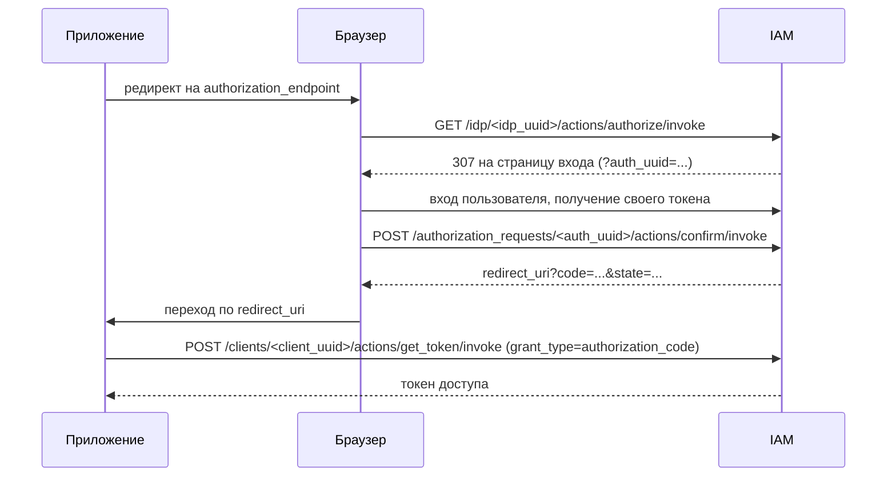

# OAuth2 Authorization Code Flow

IAM может выступать OpenID Connect Identity Provider (IdP) для внешних
приложений. Приложение (Relying Party) перенаправляет пользователя в IAM,
пользователь входит в систему, а приложение получает одноразовый
**код авторизации** и обменивает его на токен доступа.

## Сущности

* **IAM-клиент** (`/v1/iam/clients/<client_uuid>`) — выпускает токены. Его
  `client_id` используется как `audience` токена.
* **IdP** (`/v1/iam/idp/<idp_uuid>`) — связывает IAM-клиента с разрешёнными
  callback URI. Основные поля:
    * `iam_client` — IAM-клиент, от имени которого выпускаются токены;
    * `scope` — scope по умолчанию (`openid`);
    * `callback` — разрешённые значения `redirect_uri`, один из вариантов:
        * `callback_uri` — точное совпадение с `callback`;
        * `callback_uri_list` — точное совпадение с любым элементом `callbacks`;
        * `callback_regexp` — полное совпадение с регулярным выражением `pattern`;
    * `nonce_required` — обязателен ли `nonce` (по умолчанию `true`).
* **Запрос авторизации** (`/v1/iam/authorization_requests/<uuid>`) —
  короткоживущая запись, которую создаёт `authorize`. Хранит `state`, `nonce`,
  `scope`, `redirect_uri`, сгенерированный `code` (UUID) и, после
  подтверждения, выпущенный токен.

## Discovery

IdP публикует свою OpenID-конфигурацию:

```text
GET /v1/iam/idp/<idp_uuid>/.well-known/openid-configuration
```

| Поле                     | Эндпоинт                                                  |
|--------------------------|-----------------------------------------------------------|
| `issuer`                 | `/v1/iam/clients/<client_uuid>`                           |
| `authorization_endpoint` | `/v1/iam/idp/<idp_uuid>/actions/authorize/invoke`         |
| `token_endpoint`         | `/v1/iam/clients/<client_uuid>/actions/get_token/invoke`  |
| `userinfo_endpoint`      | `/v1/iam/clients/<client_uuid>/actions/userinfo`          |
| `jwks_uri`               | `/v1/iam/clients/<client_uuid>/actions/jwks`              |
| `end_session_endpoint`   | `/v1/iam/clients/<client_uuid>/actions/logout/invoke`     |

Поддерживается только тип ответа `code`.

## Схема



### 1. Authorize

```text
GET /v1/iam/idp/<idp_uuid>/actions/authorize/invoke
    ?client_id=<client_id>
    &redirect_uri=<redirect_uri>
    &state=<state>
    &response_type=code
    &scope=openid
    &nonce=<nonce>
```

IAM проверяет, что:

* `client_id` совпадает с IAM-клиентом IdP;
* `redirect_uri` разрешён настройкой `callback` IdP;
* `nonce` передан, если включён `nonce_required`.

Затем IAM создаёт запрос авторизации со случайным `code`, действующий
10 минут, и отвечает `307` на страницу входа IAM:

```text
/?auth_uuid=<auth_uuid>&client_uuid=<client_uuid>&idp_uuid=<idp_uuid>
```

### 2. Confirm

После входа пользователя страница логина подтверждает запрос его токеном:

```bash
curl -X POST \
  -H "Authorization: Bearer <user_token>" \
  '<base_url>/v1/iam/authorization_requests/<auth_uuid>/actions/confirm/invoke'
```

IAM выпускает для пользователя новый токен с IAM-клиентом IdP, запрошенными
`scope` и `nonce` и текущим проектом пользователя. Токен привязывается к
запросу авторизации. В ответе возвращается callback URL:

```json
{
  "redirect_url": "<redirect_uri>?code=<code>&state=<state>"
}
```

Чтобы вместо JSON получить `307` редирект на этот URL, передайте
`redirect_me=true`.

### 3. Обмен кода на токен

```bash
curl -X POST \
  '<base_url>/v1/iam/clients/<client_uuid>/actions/get_token/invoke' \
  --data-urlencode 'grant_type=authorization_code' \
  --data-urlencode 'code=<code>' \
  --data-urlencode 'redirect_uri=<redirect_uri>'
```

IAM находит запрос авторизации по `code`, удаляет его и возвращает токен,
выпущенный на шаге confirm. Код одноразовый: для неизвестного или уже
использованного кода возвращается ошибка неверных учётных данных.

## IdP из спецификации бутстрапа

Инсталляция может подняться сразу с нужными IdP: в спецификации бутстрапа
можно передать список `idps`, и бутстрап создаст каждый IdP из него вместе с
IAM-клиентом, от имени которого тот выпускает токены. Оба создаются в
сервисном проекте. IdP или клиент, чей `uuid` уже существует, не меняется,
поэтому повторный бутстрап не трогает то, что было создано или отредактировано
раньше; запись, которую не удалось прочитать, пишется в лог и пропускается.

```json
{
  "idps": [
    {
      "uuid": "<idp uuid>",
      "name": "Elementizer agent",
      "description": "Sign an agent in to the realm",
      "scope": "openid",
      "nonce_required": true,
      "callback": {
        "kind": "callback_regexp",
        "pattern": "^http://127\\.0\\.0\\.1:[0-9]+/callback$"
      },
      "iam_client": {
        "uuid": "<client uuid>",
        "name": "Elementizer agent",
        "description": "Agents deploying through Elementizer",
        "client_id": "elementizer-agent",
        "registration_auto_provision": false
      }
    }
  ]
}
```

`callback` принимает любой из трёх вариантов, описанных выше. Клиент
создаётся со случайным секретом, которого никто не знает: при обмене кода
авторизации на токен секрет клиента не передаётся, поэтому публичному
клиенту — например, агенту на машине пользователя — он не нужен.
