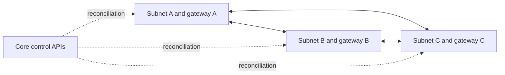

# Common CloudNetworkLink

See the
[API and operations guide](openstack-multicloud.md) and the
[Russian architecture description](cloud-net-link-design.ru.md).

## Topology

A link connects two or more existing Core IPv4 subnets. The common API imposes
no fixed endpoint-count limit. Their networks select provider
connections; API placement does not select a special local side. Every pair
of endpoints gets one direct OpenVPN connection, for `N*(N-1)/2` sessions.
One dedicated gateway per cloud endpoint serves all its peers. Endpoint `role`
selects `server` (accept), `client` (initiate), or `auto` (default).
Explicit roles override UUID order; two `auto` peers use the smaller UUID as
server. Two explicit servers or two explicit clients cannot form a direct
pair and are rejected. Each gateway may have both roles when set to `auto`.
The selected server uses a shared listener for its incoming connections.

Traffic retains original IPv4 addresses. There is no L2 extension, SNAT,
inter-site transit through a third gateway, BGP or HA. CIDRs in a link must
not overlap. A subnet belongs to one link until its cleanup completes.
A pre-existing local routed SDK gateway uses the same transport, with explicit
`subnet`, `agent` and public IPv4 `endpoint`; an explicit `client` needs no
public address and can omit `endpoint`. Its EVPN attachment and local
routes are operator prerequisites in this mode. Alternatively, an `ovs_evpn`
endpoint with `external_subnet` and `gateway_image` creates an ordinary managed
Core Node with private and flat transport ports. Config/Service start its
separate link agent, and the SDN driver advertises peer prefixes behind the
forwarding port. One physical local gateway supports one endpoint.

An on-premises gateway behind NAT can be `client` while an OpenStack gateway
is `server`. A managed native client's flat port needs outbound reachability,
not a public address. Application traffic is bidirectional inside the tunnel:
cloud load balancers can initiate connections to on-premises private backends.
Explicit cloud clients do not allocate floating IPs or open transport ingress.
Roles are immutable until the endpoint is removed and reattached.

## Transport and ownership

The default profile is OpenVPN 2.6+, TUN, TCP/443, TLS certificates and
`tls-crypt-v2`. UDP is an explicit option. TCP/443 does not disguise the
protocol as HTTPS or guarantee passage through provider DPI. There is no
automatic transport detection or failover. Throughput and DPI behavior on
production providers remain unmeasured.

Core owns a CA and distinct server/client identities for each endpoint.
Clients verify the exact server identity; the server accepts only configured
client identities. CA private keys stay on Core. OpenVPN runs with a kernel
route and CCD `iroute` for each subnet behind an incoming client. Client
instances carry only their direct neighbor's subnet. Gateway firewall rules
allow only declared local/remote prefixes. New tunnel connections are blocked from
accessing services on the gateway host itself. Neutron allowed address pairs
permit those source addresses without disabling port security.

Certificates renew within 30 days of expiration. CA renewal preserves its
signing key and subject so old/new trust stores accept independently updated
leaves. Removed peers lose their CCD entries, routes and outgoing connections.
Targets and private configuration are delivered through the SDK agent protocol.
Private files have mode `0600`; management sockets are root-only.

## Bootstrap without guest access to Core

1. Core creates gateway ports, security groups and listening endpoints' floating IPs through
   provider APIs. Every listener address is available before any VM boots.
2. Core generates complete configurations and passes compressed Nova
   user-data to each VM. The OpenStack driver validates the actual encoded
   size against Nova's 65,535-character limit before creating a server.
   Cloud-init installs OpenVPN and dependencies, writes
   private files, enables forwarding/firewall and starts transport services.
3. The SDK agent starts afterwards and retries Core access. OpenVPN bootstrap
   does not call Core APIs. Package repositories must be reachable.
4. Agents apply later desired state and report target hash, gateway generation
   and tunnel health. Core declares `ACTIVE` only for the current topology.

The Core general-service host needs the OpenVPN binary for supported
`tls-crypt-v2` key generation; its image installer installs it. It does not
need VPN interfaces. A private Core API requires a local network attachment
and return route to a connected subnet, independently of the mesh mechanism.
Saved gateway configuration survives loss of Core; subsequent changes and
provider recovery need a functioning controller and provider API.

## Convergence and recovery

Adding an endpoint updates every gateway's peer configuration, Neutron allowed
address pairs and DHCP host routes. Existing guests must renew DHCP to learn
new routes. Existing overlapping host routes through another gateway are
rejected. Membership updates are asynchronous until `ACTIVE`.

Removing a cloud endpoint immediately fences its Nova gateway, even when a
survivor is unavailable. Surviving peers must report the new target before
the remaining port, address reservation and bindings are released. Revocation
on an unavailable local endpoint remains asynchronous. Link deletion
retains a `DELETING` record and subnet/connection bindings until owned provider
objects, targets and routes are cleaned. Failures remain retryable. Unrelated
routes and provider resources are preserved.

A missing cloud VM is recreated through provider APIs. The `recover_gateway`
action explicitly replaces a failed Nova VM while retaining its port and
floating IP; it requires update permission and does not need the failed
agent. Readiness includes the new server ID so old agent health cannot mark
the replacement ready. Single-gateway recovery causes an interruption; HA
is outside this implementation.

## Requirements and limits

Core and gateway images require an SDK containing `gcl_sdk.cloud.openvpn`
and `OpenVPNCapabilityDriver`. PaaS images require SDK agents that use the
configured Core node identity. See the [SDK and agent requirements](openstack-multicloud.md#sdk-and-agent-requirements).

`ACTIVE` reports transport health. Verify application connectivity and security
groups separately, including traffic in both directions, membership changes
and connectivity between surviving sites after a site outage. Tests of
independent provider failures require independent installations; separate
projects in one installation share its failure domain. Selectel and
VK Cloud/Sprut are unvalidated.
