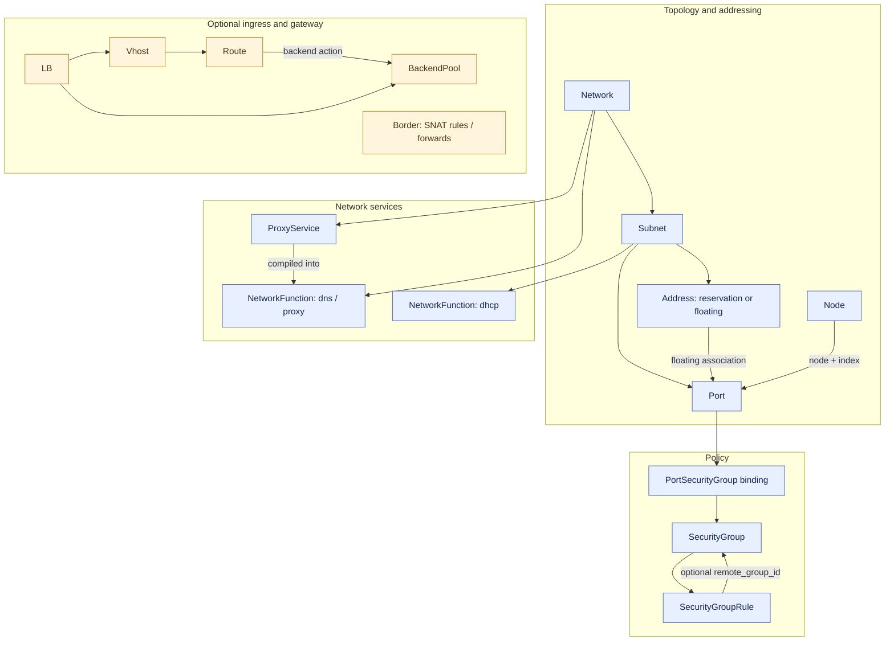
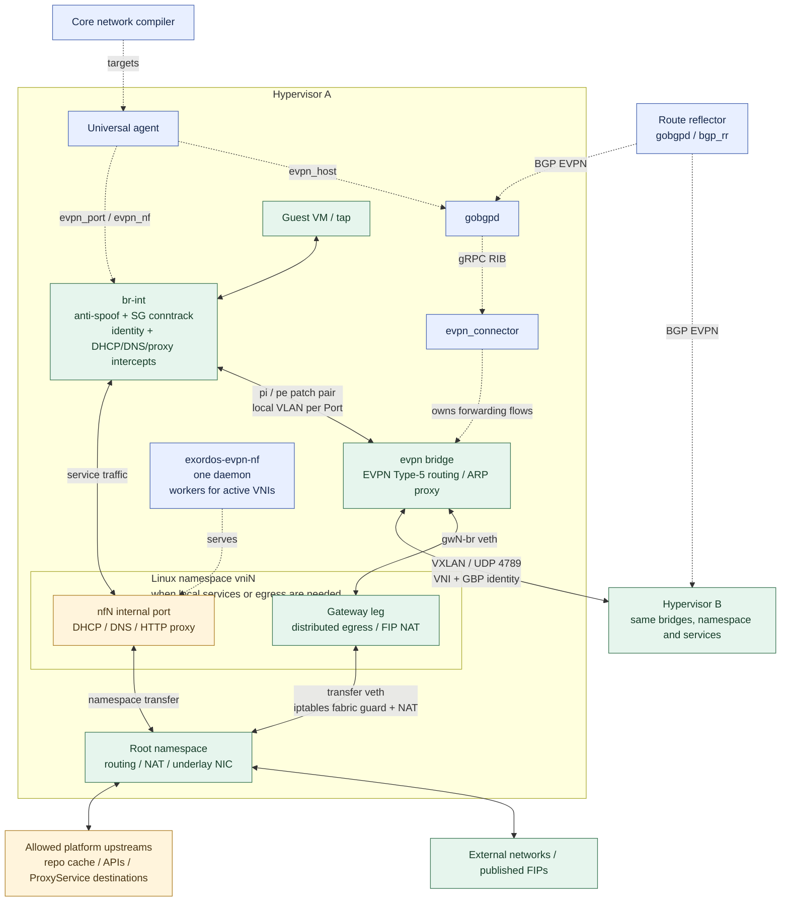

# Network dataplane

Core compiles API resources into universal-agent targets. Hypervisors apply
OVS/EVPN policy, services and NAT. [API contract](sdn-api-contract.md) ·
[Deployment](realm-connectivity-sdn.md) · [Quickstart](private-network.md).

## Resources

Network is the isolation boundary; Subnet provides addressing. Port is a NIC;
Address reserves an IP or binds a FIP. Node/NodeSet `default_network` creates a
primary Port and optional FIP. Additional ordinary Node NICs are independent
Ports. SG rules and memberships use separate resources.

NetworkFunction rows hold owned service overrides: DHCP per Subnet, DNS/proxy
per Network. Core seeds them with empty user config and computes defaults during
compilation. DHCP supports `filename`, `lease_seconds`; DNS supports `forwarders`,
`zone_suffix`, `platform_names`. Proxy is installation-owned and not user-editable.
DNS slices also carry the generated Network-wide A/PTR directory; it is not a
user-editable override. Per-Port records remain host-local and are the authority
for DHCP leases and proxy caller identity. DHCP selects the settings of the
guest's Subnet, so Subnets sharing a VNI retain independent lease times and
boot filenames. Withdrawing a slice preserves other slices sharing its host.
ProxyService adds HTTP doors with fabric-derived caller context.

## Hypervisor packet paths

- The SDK agent owns `br-int`; the connector owns `evpn`. A local VLAN and patch
  pair connect each Port to the fabric; this VLAN is independent of the VNI.
- EVPN Type-5 and VNI/RT isolate networks. Per-VNI namespaces isolate local NAT
  and services; conntrack zones isolate guest policies with overlapping IPs.
- Anti-spoofing uses `port_security`. SG rules use conntrack/OpenFlow on `br-int`.
  `enforce_security_group` controls unbound default-deny behavior.
- DHCP/DNS/proxy intercepts precede tenant SG rules. DNS/HTTP interception targets
  the metadata IP and subnet gateway; traffic to other guests follows SG policy.
- Remote SG membership uses low-16-bit `pkt_mark` across patches and VXLAN GBP
  across hosts; [identity limits](security-group-remote-access.md) apply per Network.
- Egress uses local gateway/NAT. A FIP adds symmetric 1:1 NAT and external ARP
  proxying on its serving host. Allocation reuse does not wait for offline
  hosts; stale forwarding is removed when they reconcile.
- The RR distributes routes and is outside the packet path. Retained forwarding
  during BGP loss covers synchronized routes, not new or moved guests.

GoBGP's management API uses the root-only Unix socket `/run/gobgpd/api.sock`.
The agent reconciles the systemd unit and connector channel; the socket directory
has mode `0700`, and the TCP API, pprof and metrics listeners are disabled. Inspect the
local RIB with `sudo gobgp --target unix:///run/gobgpd/api.sock neighbor`.

## Target resources

| Kind | Consumer and output |
| --- | --- |
| `pool_port` | Pool agent: NIC identity, VM attachment and independent hotplug |
| `pool_machine` | Pool agent: VM lifecycle, with ports and volumes as dependencies |
| `evpn_port` | Serving host: IP/MAC/VNI/RT, DHCP facts, SG rules, identity, FIPs and service selectors |
| `evpn_host` | Hypervisor: gobgpd/connector configuration and published-address guards |
| `evpn_nf` | One NF/host slice: DHCP/DNS/proxy settings, independent of Port hashes |
| `bgp_rr` | Reflector agent: ASN and dynamic-peer prefixes |
| `evpn_subnet` | Core driver's reconciliation marker, not a packet-processing hop |
| `net_lb_iaas`, `net_lb_paas` | LB placement and configuration builders |
| `paas_lb_agent`, `paas_lb_node` | Core agent or LB VM: nginx listeners, routes, backends and certificates |
| `net_border_iaas`, `net_border_paas` | Gateway placement and NAT builders |
| `border_agent`, `border_node` | Gateway agent: nftables SNAT/DNAT |
| `target_node_set` | Compute provisioning for dedicated LB/Border nodes |

`pool_port` uses the canonical Port UUID. Its declaration is stored before
VM creation; the agent reports `attached: false` until the NIC is present.
The machine waits for port declarations from the same boot phase before starting
or restarting. A missing or ambiguous boot network keeps its primary port pending.
The machine consumes these declarations when created, while subsequent
attachment changes converge through `pool_port` without updating the VM target.
The primary flat NIC uses the installation boot network during netboot, keeping
its UUID and MAC; secondary NICs retain their own networks.

`flat_bridge` uses the existing bridge/ISC DHCP path without EVPN SG/NF handling.
LB and Border are independent optional resources: LB provides nginx L4/L7
listeners, Border provides an explicit NAT gateway. Overlay egress needs neither.
Nested realms repeat the stack inside their parent VM.

## Source map

- Core `compute/dm/models.py`: Network, Subnet, Port and lifecycle.
- Core `user_api/network/dm/models.py`: Address, SG, NF, ProxyService and LB/Border.
- Core `network/driver/{evpn,flat}.py`: compilation and allocation.
- SDK `paas/dm/evpn.py`: target models.
- SDK `agents/universal/drivers/evpn/`: fabric, policy, NAT and cleanup.
- SDK `agents/universal/drivers/{evpn_nf,evpn_proxy,evpn_records}.py`: services.
