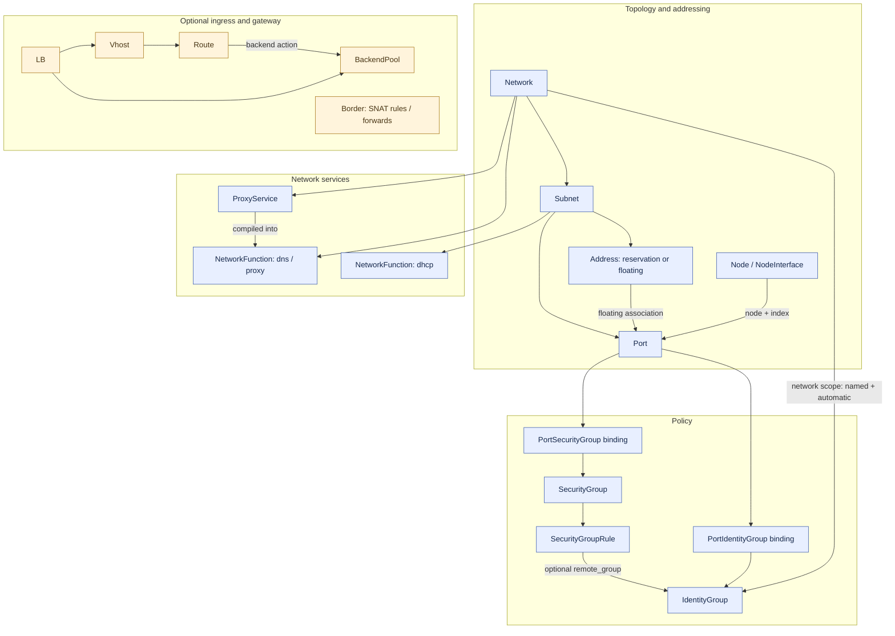
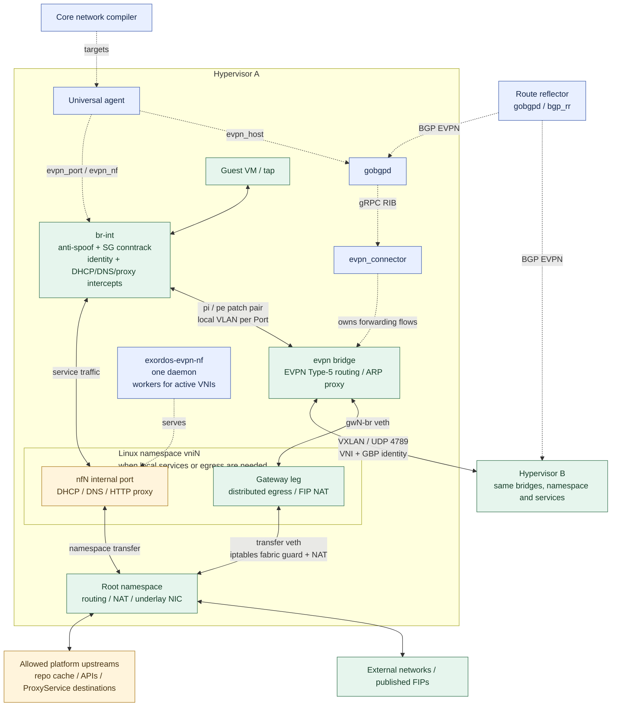
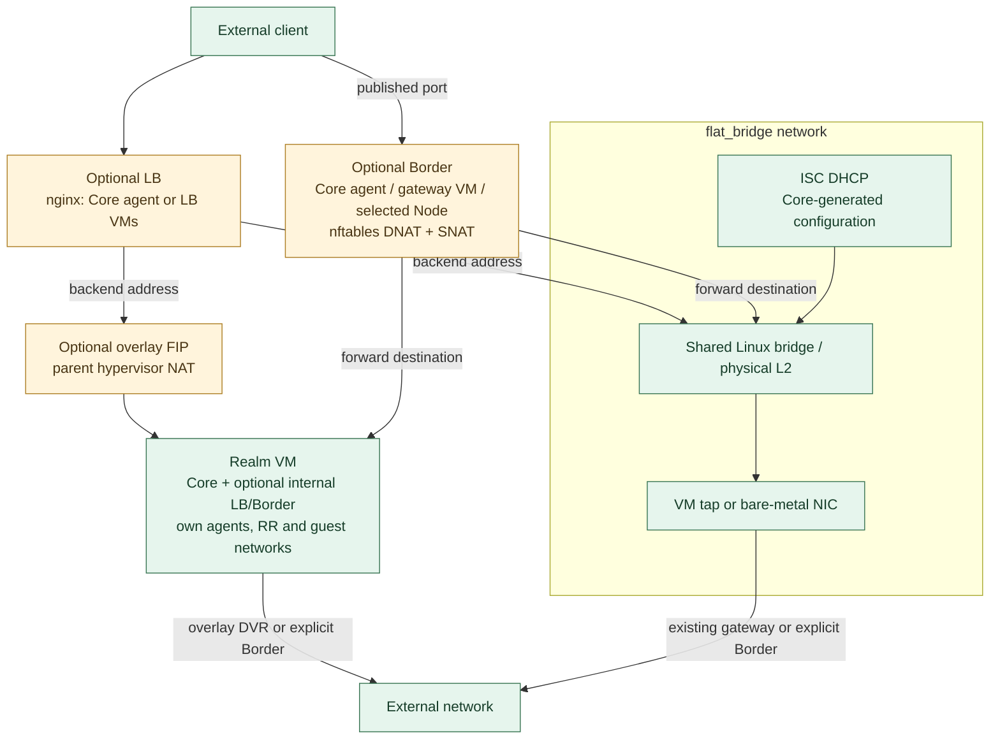

# Network dataplane

This is the inventory of networking entities implemented by Core's `sdn`
branch and the matching SDK drivers. It covers both `ovs_evpn` and
`flat_bridge`, including optional ingress and service components. API fields
and update semantics are in the [SDN API contract](sdn-api-contract.md);
commands are in [Private networks](private-network.md).

## Entities and their relationships

API objects describe intent. Core compiles them into target resources;
the universal agent realizes those targets on the selected node. VNI, route
targets, local VLANs, OpenFlow ports and Linux namespaces are implementation
objects, not additional resources callers must create.

Arrows denote ownership or references, not packets. LB and Border are
independent resources; their backends/forward destinations are addresses,
so they do not require a direct Network or Port reference.

| Entity | Role and realization |
| --- | --- |
| `Network` | Driver and sharing boundary. EVPN allocates one VNI and import/export route targets; the effective MTU is compiled into port DHCP data. Flat uses the existing shared bridge. |
| `Subnet` | CIDR, allocation range, gateway/DNS DHCP options, placement and floating-pool flags. `floating_pool=true, placeable=false` is an address pool, not a guest segment. |
| `Port` | One NIC, selected by `node` + `index`, with MAC/IP, enabled and `port_security` settings (anti-spoof enforcement is on overlay `br-int`). Overlay compiles to `evpn_port`. Service switches are `dhcp`, `dns`, `network_identity`; `config` accepts the legacy `simple.public` allocation request only. |
| `Node`, `NodeInterface` | Compute placement and the NIC declaration which can create a Port. `Node.networking` is a create-time subnet selector; it is not another forwarding object. |
| `Address` | IPAM ledger entry. `reservation` reserves an IP; `floating` can associate with a Port through `port`. Ordinary NIC addresses also have ledger entries. Overlay FIP becomes host-local 1:1 NAT, not another interface or NF. |
| `SecurityGroup`, `SecurityGroupRule` | Shared ingress/egress allow rules, with protocol, optional port and remote IP/prefix or IdentityGroup. Compiled into conntrack/OpenFlow policy on `br-int`. |
| `PortSecurityGroup` | Explicit Port ↔ SG membership. Several groups union their allow rules. No binding means no SG filtering; an attached empty group denies new tenant traffic. Anti-spoof and infrastructure service handling still apply. |
| `IdentityGroup`, `PortIdentityGroup` | Named peer identity and explicit membership. Each network has an automatic identity unless opted out on the Port. Up to 16 groups per network, including the automatic group; compiled as a bitmask carried with VXLAN GBP. Identity grants no access by itself. |
| `NetworkFunction` | Owned service configuration. `generated_config` plus caller `config` form `effective_config`; `provenance` controls refresh ownership. Runtime services are DHCP, DNS and proxy; see below. |
| `ProxyService` | Optional HTTP door from an overlay to a Node destination, or an operator-authorized address. Compiles into the network's proxy NF; optional domain is added to DNS. The proxy stamps caller identity; the upstream must still authenticate. |
| `LB`, `Vhost`, `Route`, `BackendPool` | nginx L4/L7 ingress: TCP, UDP, HTTP or HTTPS listeners, TLS certificates, backend pools and HTTP routing. Route actions include backend forwarding, redirect and static content; modifiers cover headers and URL rewriting. SSH external sources and PROXY protocol are optional Vhost configuration, not separate resources. See [LB API](load_balancer.md). |
| `Border` | Explicit SNAT/masquerade rules and TCP/UDP DNAT forwards, applied with nftables. Runs on the Core agent, a dedicated gateway VM, or an explicitly selected Node. It is separate from the overlay's built-in distributed egress. |

## Network functions

| Kind | Owner | Runtime and configuration |
| --- | --- | --- |
| `dhcp` | Subnet | Static Port MAC/IP and Subnet options; `filename`, `lease_seconds`. No lease database or TFTP server. Intercept follows Subnet DHCP and the Port override. |
| `dns` | Network | Internal A/PTR records and upstream resolution over UDP/TCP; `forwarders`, `zone_suffix`, `platform_names`. Caller-added forwarders must be public IPv4 addresses; installation defaults may include private resolvers. |
| `proxy` | Network | Allowlisted netboot/cache paths, platform endpoints, authenticated API upstreams and ProxyService doors. Installation defaults generate `forwards`, `ports`, `apis`; `services` is compiled from ProxyService objects; callers cannot edit/delete this NF. |
| `splitter` | Legacy model kind | Still accepted by the model with `rules`, but the current compiler selects only `dhcp`, `dns`, `proxy` for runtime NF slices. It is not seeded or used as a default SG. Use SecurityGroup + SecurityGroupRule + PortSecurityGroup for active policy. |

Core seeds missing service NFs and refreshes generated defaults. User edits
to DHCP/DNS keep their overrides. The proxy remains installation-owned.
FIP, SG, identity, LB and Border are not additional NF kinds. There is no
user-configurable NF graph, `vip` Port kind or inter-VRF forwarding edge.

## Overlay on the hypervisors

Solid arrows are packet paths. Dashed arrows are configuration or BGP
control paths. The second hypervisor has the same local components as the
first; its compact box avoids repeating the implementation.

- **Bridge ownership:** the SDK agent owns `br-int`; `evpn_connector`
  owns all forwarding flows on `evpn`. They do not write each other's flow
  tables. Guest patches are `pi<VLAN>` / `pe<VLAN>`; the local VLAN is per
  Port, not the network VNI. NF ports also receive local VLANs.
- **Isolation:** VNI/RT separate networks; `vni<N>` namespaces separate
  host-local service/NAT state; conntrack zones separate guest policy even
  when tenant CIDRs overlap. SG identity is a GBP bitmask, not an IP list.
- **Services:** the shared `exordos-evpn-nf` daemon reads per-VNI records;
  DHCP/DNS use the NF port and HTTP terminates on the namespace kernel
  stack. Service intercepts are above tenant SG policy.
- **Egress:** each participating host provides its local gateway. The
  namespace and root namespace use transfer veths, routing and iptables;
  the fabric guard excludes management/underlay destinations. This does
  not require a Border resource.
- **Floating ingress:** the serving hypervisor answers ARP on its underlay
  segment and applies symmetric NAT to the guest. The floating address is
  not assigned to the guest or a host interface. Moving the Port moves
  this realization; it does not preserve live conntrack sessions.
- **Fabric:** RR reflects routes and is not on the guest packet path.
  The connector keeps its last synchronized forwarding state during BGP
  loss; that state does not promise reachability to new or moved guests.

## Flat networking, LB, Border and nested realms

These are deployment alternatives and optional additions, not mandatory
stages in every guest's path. A realm repeats the same stack inside its
own installation; the parent only sees its VM/Port and any published FIP.

`flat_bridge` updates the configured ISC DHCP service; it does not build an
EVPN fabric or apply the overlay SG/NF pipeline. An omitted Node networking
selector preserves
the legacy flat default; `networking=[]` requests no automatic Port.

LB `type.kind=core_agent` uses the Core agent; `core` provisions a NodeSet
of LB VMs. Border uses the Core agent by default; `type.kind=core`
provisions one VM, and `node` pins it to an existing Node's agent. A
dedicated Border does not implement VRRP or conntrack replication.

## Compiled target resource inventory

Intermediate targets are included so they are not mistaken for independent
packet-processing elements. Scheduling and compute provisioning are
provided by the existing universal-agent/NodeSet machinery.

| Target kind | Granularity / consumer | Output |
| --- | --- | --- |
| `evpn_port` | Port → hosting hypervisor agent | MAC/IP/VNI/RT, DHCP facts, SG rules, identity, FIPs, service selectors; tap wiring, patches, OpenFlow and NAT. |
| `evpn_host` | Hypervisor → its agent | ASN, RR addresses, installation's published addresses; gobgpd and connector fabric configuration/guards. |
| `evpn_nf` | NF × host, UUID `uuid5(nf, node)` → host agent | Per-VNI DHCP/DNS/proxy configuration. Ports carry intercept selectors; proxy door port changes can also change port targets. |
| `bgp_rr` | RR node → its agent | ASN and dynamic-peer prefixes; route-reflector gobgpd configuration. Can share a node/daemon with `evpn_host`. |
| `net_lb_iaas`, `net_lb_paas` | LB builder stages | Provision placement, then compile Vhosts/Routes/BackendPools. |
| `paas_lb_agent`, `paas_lb_node` | Core agent or LB VM agent | nginx L4/L7 configuration, certificates and optional external sources. |
| `net_border_iaas`, `net_border_paas` | Border builder stages | Provision/select gateway, then compile inline NAT rules. |
| `border_agent`, `border_node` | Core agent or selected/dedicated Node agent | Agent-owned `exordos_border` nftables table. |
| `target_node_set` | LB/Border IaaS derivative → compute NodeSet machinery | LB replicas or the single dedicated Border VM; no forwarding rules itself. |

## Source map and further reading

The inventory is checked against these implementation files, not the
historical session contract:

- Core `exordos_core/compute/dm/models.py`: Network, Subnet, Port and NICs.
- Core `exordos_core/user_api/network/dm/models.py`: address ledger,
  policy/bindings, NFs, ProxyService, LB children and Border.
- Core `exordos_core/network/driver/{evpn,flat}.py`: allocation,
  compilation and service seeding.
- Core `exordos_core/network/{evpn,lb,border}/dm/models.py` and LB/Border
  builders: target kinds and placement.
- SDK `gcl_sdk/paas/dm/evpn.py`: shared target fields.
- SDK `gcl_sdk/agents/universal/drivers/evpn/`: fabric, bridge policy,
  per-VNI namespace, NAT and cleanup.
- SDK `gcl_sdk/agents/universal/drivers/{evpn_nf,evpn_proxy,evpn_records}.py`:
  host services and records.
- SDK `gcl_sdk/agents/universal/drivers/{lb,border}.py`: nginx/nftables.
- Connector `evpn_connector/`: EVPN RIB and fabric forwarding.

See [Realm connectivity SDN](realm-connectivity-sdn.md) for design rationale,
[Node interfaces](node-interfaces.md) for NIC declarations, and
[Networking for managed services](paas-networking-guide.md) for placement.
