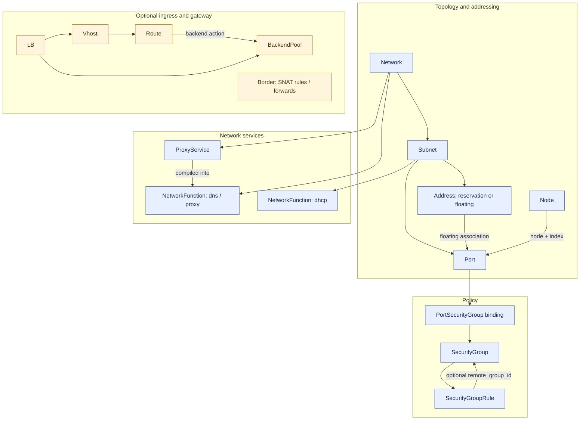
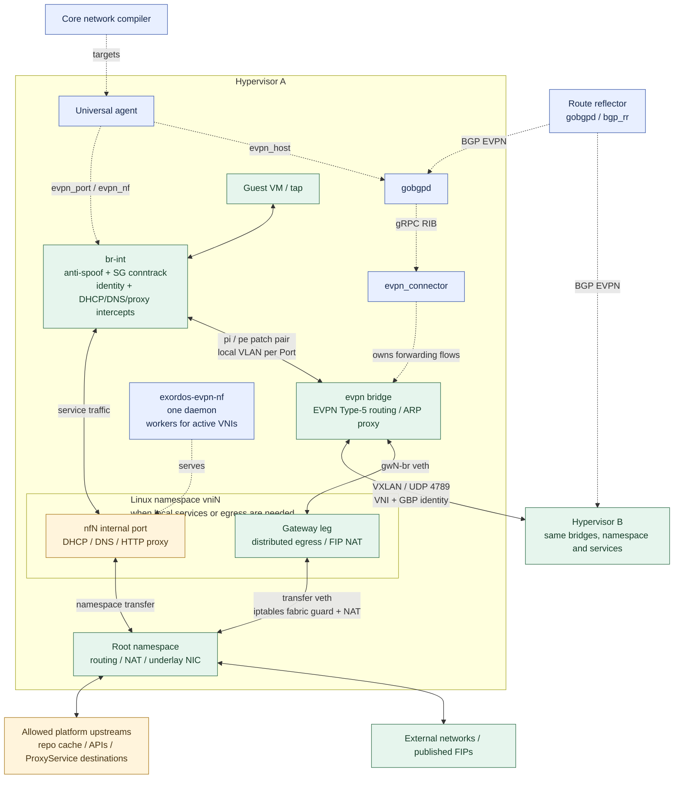

# Dataplane сети

Core компилирует ресурсы API в задания universal-agent. Агенты гипервизоров
применяют OVS/EVPN, политику, сервисы и NAT.
[API](sdn-api-contract.ru.md) · [Развёртывание](realm-connectivity-sdn.md).

## Ресурсы

Network задаёт границу изоляции, Subnet — адресацию, Port — NIC.
Address резервирует IP или связывает FIP с Port. Node/NodeSet `default_network`
создаёт основной Port и необязательный FIP. Дополнительные NIC обычной Node —
самостоятельные Port. Правила SG и привязки к портам — отдельные ресурсы.

NetworkFunction хранит пользовательские настройки: DHCP для Subnet, DNS/proxy
для Network. Core создаёт их с пустым `config`, значения по умолчанию вычисляет
при компиляции. DHCP принимает `filename`, `lease_seconds`; DNS — `forwarders`,
`zone_suffix`, `platform_names`. Proxy управляется конфигурацией инсталляции;
ProxyService добавляет HTTP-доступ к отдельным сервисам.
DNS-срезы также содержат сформированный Core каталог A/PTR для всей Network;
пользователь не может переопределить его через настройки NF. Записи Port остаются
локальными на хосте и определяют право на DHCP-аренду и личность вызывающего proxy.
DHCP выбирает настройки Subnet гостя: подсети одного VNI сохраняют собственные
сроки аренды и boot filename. Удаление среза сохраняет остальные срезы на хосте.

## Путь пакетов на гипервизоре

- SDK управляет `br-int`, connector — `evpn`. Для каждого Port создаются локальный
  VLAN и пара patch-портов; номер VLAN не связан с VNI.
- EVPN Type-5 и VNI/RT изолируют сети. Пространства имён разделяют NAT и сервисы,
  conntrack zones — политику портов с пересекающимися адресами.
- `port_security` включает anti-spoofing. SG применяются через conntrack/OpenFlow;
  `enforce_security_group` задаёт default-deny при отсутствии привязок.
- Перехват DHCP/DNS/proxy расположен выше SG. DNS/HTTP перехватываются для
  metadata IP и шлюза подсети; обращения к другим гостям проходят обычную политику.
- Маска remote SG передаётся через младшие 16 бит `pkt_mark` между мостами и
  VXLAN GBP между хостами. [Лимиты](security-group-remote-access.md) действуют на Network.
- Исходящий трафик использует локальный gateway/NAT. FIP добавляет симметричный
  1:1 NAT и ARP proxy на обслуживающем хосте. Повторное использование адресов
  не ждёт недоступный хост; устаревшее состояние удаляется при его согласовании.
- RR распространяет маршруты и не участвует в передаче гостевых пакетов.
  Сохранённые маршруты при потере BGP не покрывают новых или перемещённых гостей.

Управляющий API GoBGP доступен root через Unix socket `/run/gobgpd/api.sock`.
Агент согласовывает systemd unit и канал connector; каталог сокета имеет права
`0700`, TCP API, pprof и HTTP-метрики отключены. Проверить соседей можно командой
`sudo gobgp --target unix:///run/gobgpd/api.sock neighbor`.

## Target resources

| Kind | Получатель и назначение |
| --- | --- |
| `pool_port` | Pool-агент: идентичность NIC, подключение к VM и независимый hotplug |
| `pool_machine` | Pool-агент: жизненный цикл VM с портами и дисками как зависимостями |
| `evpn_port` | Гипервизор: IP/MAC/VNI/RT, DHCP, SG, identity, FIP и перехват сервисов |
| `evpn_host` | Гипервизор: конфигурация gobgpd/connector и защита опубликованных адресов |
| `evpn_nf` | NF × хост: настройки DHCP/DNS/proxy отдельно от хешей Port |
| `bgp_rr` | Агент RR: ASN и префиксы динамических соседей |
| `evpn_subnet` | Маркер сверки Core, не сетевой узел |
| `net_lb_iaas`, `net_lb_paas` | Размещение и сборка конфигурации LB |
| `paas_lb_agent`, `paas_lb_node` | Агент Core или VM LB: nginx, listeners, routes и сертификаты |
| `net_border_iaas`, `net_border_paas` | Размещение шлюза и сборка NAT |
| `border_agent`, `border_node` | Агент шлюза: nftables SNAT/DNAT |
| `target_node_set` | Создание вычислительных узлов для LB/Border |

`pool_port` использует UUID канонического Port. Описание сохраняется до
создания VM; агент сообщает `attached: false`, пока NIC не подключён.
Перед запуском или перезапуском VM агент ждёт описаний портов с той же boot-фазой.
Отсутствующая или неоднозначная boot-сеть оставляет основной порт в ожидании.
Машина получает описания портов при создании. Последующие изменения подключения
сходятся через `pool_port` без обновления задания VM. Основной flat NIC при
сетевой загрузке использует boot-сеть инсталляции, сохраняя UUID и MAC;
дополнительные NIC остаются в своих сетях.

`flat_bridge` использует существующий bridge/ISC DHCP без EVPN SG/NF.
LB предоставляет nginx L4/L7, Border — отдельный NAT-шлюз; они необязательны
для overlay egress. Вложенный realm повторяет стек внутри родительской VM.

## Исходники

- Core `compute/dm/models.py`: Network, Subnet, Port и жизненный цикл.
- Core `user_api/network/dm/models.py`: Address, SG, NF, ProxyService и LB/Border.
- Core `network/driver/{evpn,flat}.py`: компиляция и выделение ресурсов.
- SDK `paas/dm/evpn.py`: модели заданий.
- SDK `agents/universal/drivers/evpn/`: fabric, политика, NAT и очистка.
- SDK `agents/universal/drivers/{evpn_nf,evpn_proxy,evpn_records}.py`: сервисы.
