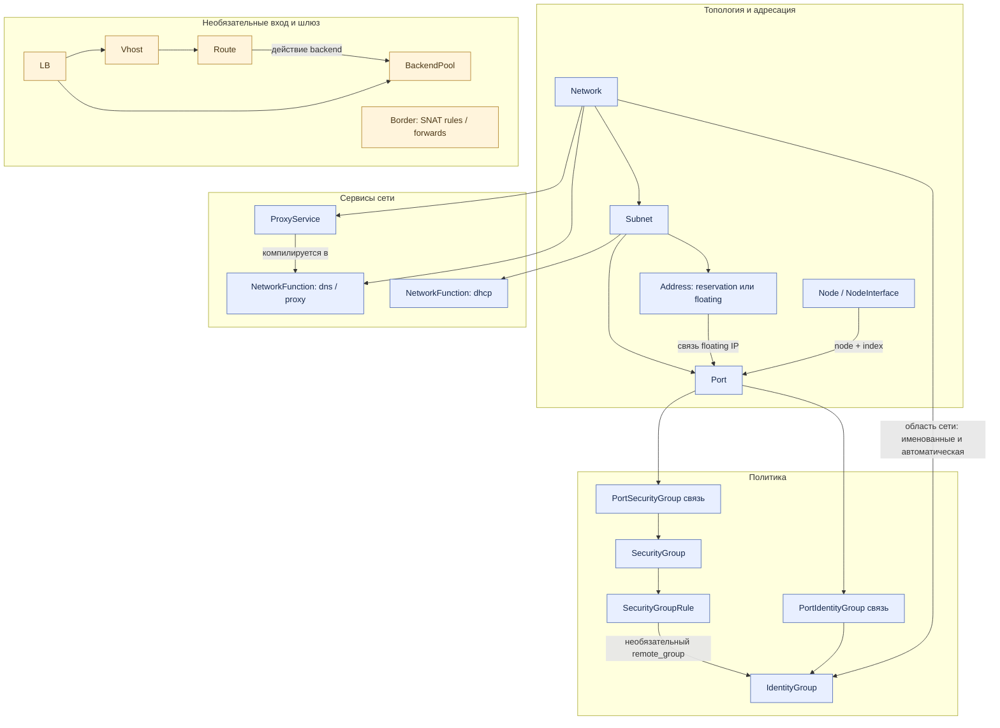
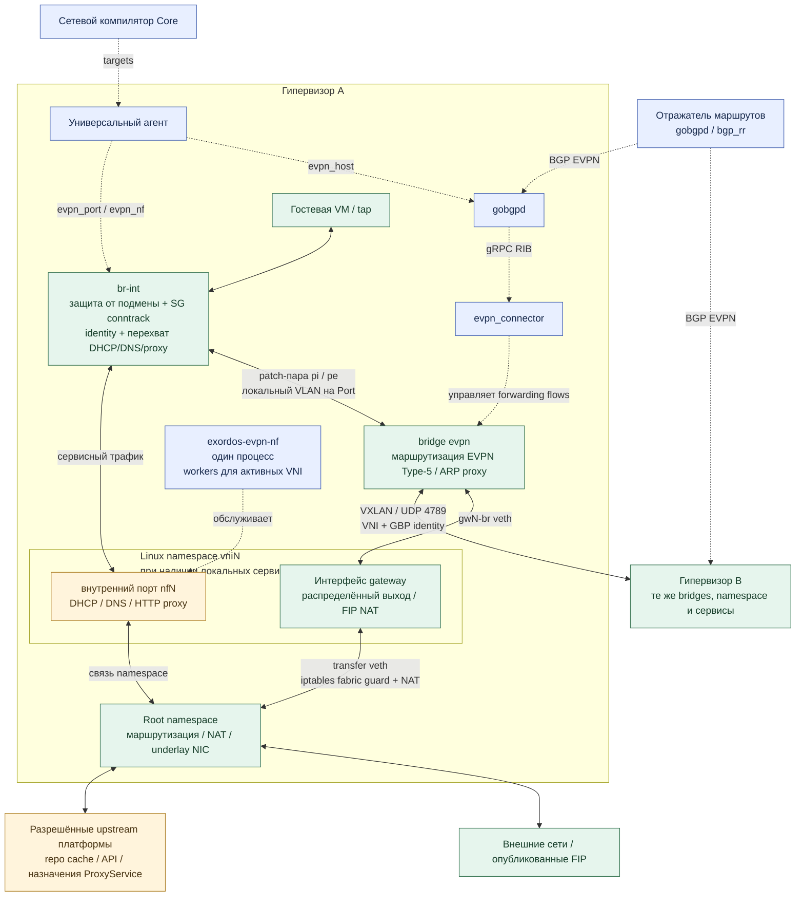
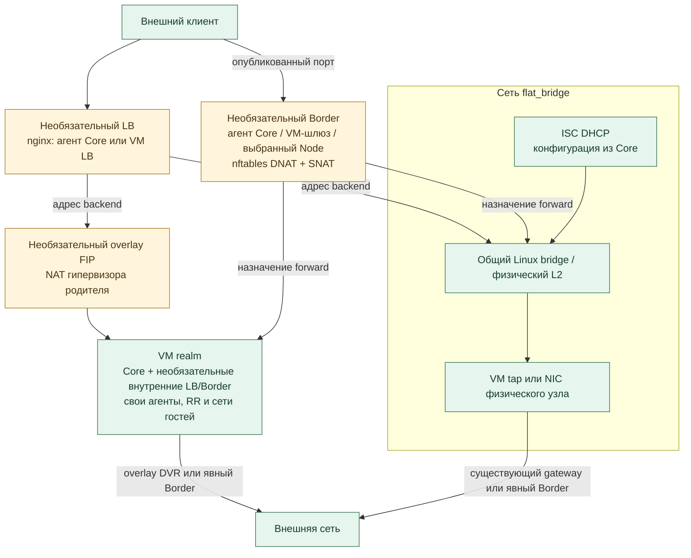

# Dataplane сети

Справочник сетевых сущностей, реализованных в ветке `sdn` Core и совместимых
драйверах SDK. Охватывает `ovs_evpn`, `flat_bridge`, публикацию сервисов,
балансировщики и шлюзы. Поля API и семантика изменений описаны в
[контракте SDN API](sdn-api-contract.ru.md), команды — в
[руководстве по частным сетям](private-network.md).

## Сущности и связи

Объекты API задают желаемое состояние. Core компилирует их в target resources,
а universal agent применяет targets на выбранном узле. VNI, route targets,
локальные VLAN, OpenFlow-порты и Linux namespaces — детали реализации;
пользователь не создаёт их как отдельные ресурсы.

Стрелки обозначают владение или ссылки, а не движение пакетов. LB и Border —
независимые ресурсы: назначения задаются адресами, прямые ссылки на Network
или Port для них не обязательны.

| Сущность | Назначение и реализация |
| --- | --- |
| `Network` | Драйвер и граница сети. EVPN выделяет VNI и import/export route targets; эффективный MTU передаётся в DHCP-данные портов. Flat использует существующий общий bridge. |
| `Subnet` | CIDR, диапазон выдачи IP, gateway/DNS для DHCP, признаки размещения и floating pool. `floating_pool=true, placeable=false` задаёт пул адресов, не сегмент для гостевых NIC. |
| `Port` | Одна NIC с привязкой `node` + `index`, MAC/IP, enabled и `port_security` (защита от подмены реализована на overlay `br-int`). Overlay компилируется в `evpn_port`. Переключатели сервисов — `dhcp`, `dns`, `network_identity`; `config` принимает только прежний запрос выделения адреса `simple.public`. |
| `Node`, `NodeInterface` | Размещение вычислительного узла и декларация NIC, из которой может создаваться Port. `Node.networking` — выбор подсети при создании, не отдельный объект пересылки пакетов. |
| `Address` | Реестр IPAM. `reservation` резервирует IP, `floating` может связываться с Port через `port`. Обычные адреса NIC тоже учитываются в реестре. Overlay FIP превращается в локальный NAT 1:1 на хосте, не в дополнительный интерфейс или NF. |
| `SecurityGroup`, `SecurityGroupRule` | Общие разрешающие ingress/egress правила: протокол, необязательный порт и удалённый IP/префикс либо IdentityGroup. Компилируются в conntrack/OpenFlow на `br-int`. |
| `PortSecurityGroup` | Явная связь Port ↔ SG. Правила нескольких групп объединяются. Без связей SG-фильтрации нет; привязанная пустая группа запрещает новые соединения гостевого трафика. Защита от подмены и обработка инфраструктурных сервисов сохраняются. |
| `IdentityGroup`, `PortIdentityGroup` | Именованная идентичность участников и явная принадлежность к группе. У сети есть автоматическая identity, от которой Port может отказаться. До 16 групп на сеть, включая автоматическую; битовая маска передаётся через VXLAN GBP. Сама identity не разрешает доступ. |
| `NetworkFunction` | Конфигурация сервиса, принадлежащего сети/подсети. `generated_config` и пользовательский `config` образуют `effective_config`; `provenance` определяет обновление сгенерированных настроек. Работающие сервисы — DHCP, DNS, proxy. |
| `ProxyService` | Необязательная HTTP-дверь из overlay к Node либо адресу с отдельным разрешением оператора. Компилируется в proxy NF сети; необязательный домен добавляется в DNS. Proxy отмечает идентичность вызывающего узла; upstream обязан сам аутентифицировать запрос. |
| `LB`, `Vhost`, `Route`, `BackendPool` | Вход через nginx L4/L7: TCP, UDP, HTTP, HTTPS, TLS-сертификаты, пулы backend и HTTP-маршруты. Действия Route: backend, redirect, статический контент; модификаторы: заголовки и переписывание URL. SSH external sources и PROXY protocol — параметры Vhost, не отдельные ресурсы. См. [LB API](load_balancer.ru.md). |
| `Border` | Явные SNAT/masquerade правила и TCP/UDP DNAT forwards в nftables. Работает на агенте Core, отдельной VM-шлюзе или выбранном Node. Это самостоятельный механизм, отдельный от встроенного распределённого выхода overlay. |

## Network functions

| Kind | Владелец | Реализация и настройки |
| --- | --- | --- |
| `dhcp` | Subnet | Статические MAC/IP Port и опции Subnet; `filename`, `lease_seconds`. Нет базы аренды или TFTP. Перехват зависит от DHCP подсети и переключателя Port. |
| `dns` | Network | Внутренние A/PTR и upstream resolution по UDP/TCP; `forwarders`, `zone_suffix`, `platform_names`. Добавляемые пользователем forwarders — публичные IPv4; defaults установки могут включать приватные resolver. |
| `proxy` | Network | Разрешённые netboot/cache пути, platform endpoints, API с собственной аутентификацией и ProxyService. Из defaults установки генерируются `forwards`, `ports`, `apis`; `services` компилируется из объектов ProxyService. пользователь не может изменить/удалить эту NF. |
| `splitter` | Сохранённый kind модели | Модель принимает `rules`, но текущий компилятор выбирает только `dhcp`, `dns`, `proxy` для runtime NF slices. `splitter` не создаётся автоматически и не служит default SG. Работающая политика задаётся через SecurityGroup + SecurityGroupRule + PortSecurityGroup. |

Core создаёт отсутствующие сервисные NF и обновляет generated defaults.
Пользовательские переопределения DHCP/DNS сохраняются. Proxy остаётся под
управлением установки. FIP, SG, identity, LB и Border — не дополнительные
виды NF. Пользовательского графа NF, Port kind `vip` и inter-VRF forwarding нет.

## Overlay на гипервизорах

Сплошные стрелки — путь пакетов, пунктир — конфигурация или BGP control plane.
На втором гипервизоре повторяются локальные компоненты первого; сокращённый
блок позволяет не дублировать их на схеме.

- **Владение bridge:** агент SDK управляет `br-int`, `evpn_connector` —
  всеми forwarding flows на `evpn`. Они не пишут в таблицы друг друга.
  Patch-пары гостевых портов — `pi<VLAN>` / `pe<VLAN>`; локальный VLAN
  выделяется на Port, а не на VNI сети. NF-порты также получают VLAN.
- **Изоляция:** VNI/RT разделяют сети; namespaces `vni<N>` разделяют
  локальное состояние сервисов/NAT; conntrack zones разделяют политики
  гостей даже при совпадающих CIDR. SG identity — маска GBP, не список IP.
- **Сервисы:** общий процесс `exordos-evpn-nf` читает записи каждого VNI.
  DHCP/DNS используют NF-порт; HTTP завершается в kernel stack namespace.
  Перехват сервисного трафика находится выше гостевой SG-политики.
- **Выход:** каждый участвующий хост предоставляет локальный gateway.
  Namespace и root namespace соединяются transfer veth; используются
  маршрутизация и iptables. Fabric guard исключает management/underlay
  назначения. Для этого пути ресурс Border не нужен.
- **Floating ingress:** обслуживающий гипервизор отвечает на ARP своего
  underlay-сегмента и выполняет симметричный NAT к гостю. Floating IP не
  назначается гостю или интерфейсу хоста. Перенос Port переносит реализацию,
  но не сохраняет живые conntrack-сессии.
- **Fabric:** RR отражает маршруты и не участвует в передаче гостевых пакетов.
  При потере BGP connector сохраняет последнее синхронизированное состояние
  forwarding. Это не гарантирует доступность новых или перенесённых гостей.

## Flat, LB, Border и вложенные realms

Это варианты размещения и необязательные дополнения, не обязательные этапы
пути каждого пакета. Realm повторяет стек внутри собственной установки;
родитель видит его VM/Port и опубликованный FIP, если он есть.

`flat_bridge` обновляет конфигурацию существующего ISC DHCP. Он не создаёт
EVPN fabric и не применяет overlay SG/NF pipeline. Отсутствие `Node.networking`
сохраняет прежний flat default; `networking=[]` отключает автоматический Port.

LB `type.kind=core_agent` использует агент Core; `core` создаёт NodeSet
VM-балансировщиков. Border по умолчанию использует агент Core; `type.kind=core`
создаёт одну VM, а `node` закрепляет его за агентом существующего Node.
Отдельный Border не реализует VRRP или репликацию conntrack.

## Все сетевые target resources

Промежуточные targets тоже перечислены: это этапы построения, не отдельные
элементы обработки пакетов. Планирование и создание VM выполняет существующий
механизм universal agent / NodeSet.

| Target kind | Гранулярность / получатель | Результат |
| --- | --- | --- |
| `evpn_port` | Port → агент гипервизора | MAC/IP/VNI/RT, DHCP facts, SG, identity, FIP, селекторы сервисов; wiring tap, patches, OpenFlow и NAT. |
| `evpn_host` | Гипервизор → его агент | ASN, адреса RR, опубликованные адреса установки; конфигурация gobgpd/connector и fabric guards. |
| `evpn_nf` | NF × host, UUID `uuid5(nf, node)` → агент хоста | Конфигурация DHCP/DNS/proxy для VNI. Селекторы перехвата находятся в Port; изменение портов ProxyService может менять и port targets. |
| `bgp_rr` | RR node → его агент | ASN и dynamic-peer prefixes; gobgpd как route reflector. Может разделять узел/daemon с `evpn_host`. |
| `net_lb_iaas`, `net_lb_paas` | Этапы LB builder | Размещение, затем компиляция Vhost/Route/BackendPool. |
| `paas_lb_agent`, `paas_lb_node` | Агент Core либо VM LB | Конфигурация nginx L4/L7, сертификаты, external sources. |
| `net_border_iaas`, `net_border_paas` | Этапы Border builder | Создание/выбор шлюза, затем компиляция NAT rules. |
| `border_agent`, `border_node` | Агент Core либо выбранного/отдельного Node | Принадлежащая агенту таблица nftables `exordos_border`. |
| `target_node_set` | Производный ресурс IaaS LB/Border → compute NodeSet | Реплики LB или одна VM Border; собственных forwarding rules нет. |

## Карта исходников и подробные руководства

Список сверяется с реализацией, а не с промежуточным контрактом прошлой сессии:

- Core `exordos_core/compute/dm/models.py`: Network, Subnet, Port, NIC.
- Core `exordos_core/user_api/network/dm/models.py`: адреса, политика и
  bindings, NF, ProxyService, LB и дочерние ресурсы, Border.
- Core `exordos_core/network/driver/{evpn,flat}.py`: выделение параметров,
  компиляция и создание сервисных NF.
- Core `exordos_core/network/{evpn,lb,border}/dm/models.py` и LB/Border
  builders: target kinds и размещение.
- SDK `gcl_sdk/paas/dm/evpn.py`: общие поля targets.
- SDK `gcl_sdk/agents/universal/drivers/evpn/`: fabric, bridge policy,
  namespaces, NAT, cleanup.
- SDK `gcl_sdk/agents/universal/drivers/{evpn_nf,evpn_proxy,evpn_records}.py`:
  локальные сервисы и записи.
- SDK `gcl_sdk/agents/universal/drivers/{lb,border}.py`: nginx/nftables.
- Connector `evpn_connector/`: EVPN RIB и forwarding fabric.

[Realm connectivity SDN](realm-connectivity-sdn.md) объясняет устройство стека,
[Node interfaces](node-interfaces.md) — декларации NIC,
[сеть управляемого сервиса](paas-networking-guide.md) — размещение.
